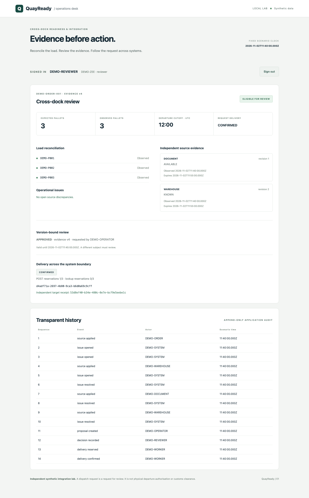
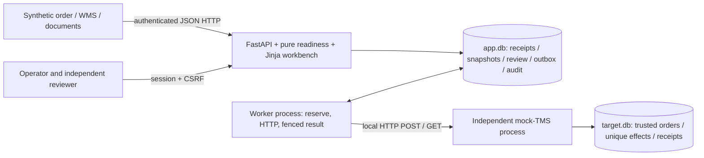

# QuayReady

**Cross-dock Readiness & Integration Lab** — a working, synthetic logistics integration exercise.

Three expected pallets. Two observed. One clear discrepancy. Correct the warehouse snapshot, request a version-bound review, and let a different person approve a dispatch **request**. Follow that request into an independent mock-TMS, including when its successful response is lost.

This independent portfolio project is not an official company application, a real WMS/TMS integration, customs clearance or physical departure authorisation. It uses synthetic data only. AI assistance contributed to implementation; passing tests does not establish the owner's personal mastery.



## What works in E1

- Strict order and complete warehouse/document snapshot ingestion; identical replay, conflicting replay, stale revisions and source conflict recovery.
- Deterministic pallet reconciliation with explicit evidence expiry, hard holds and cutoff boundaries. Current snapshots replace earlier snapshots; scan history is not summed.
- Server-rendered operational workbench with real persisted state, issue ownership, source revisions, review and delivery history. Desktop and mobile browser workflow tested.
- Stable-subject separation of duties, server-side roles/site scope, session/CSRF checks and version-bound review.
- Approval and immutable outbox creation in one SQLite transaction, enforced by deferred foreign keys.
- Separate target HTTP process and database; stable dispatch identifiers, idempotent effects and receipt lookup.
- Durable retry counters, worker leases/fencing, lookup-first uncertainty recovery and restart recovery.

The actual guarantee is **bounded at-least-once delivery attempts with an idempotent target effect under the simulated contract**. Eventual delivery and universal exactly-once processing are not promised.

## Run locally

Prerequisites: CPython **3.13**, SQLite **>=3.37** with JSON, and a local terminal. Verified runtime and checks are in [the evidence report](docs/verification.md). No Docker or paid cloud service is needed. Commands below run from this directory.

```sh
python3.13 -m venv .venv
.venv/bin/python -m pip install -r requirements-dev.lock
.venv/bin/python -m pip install -e . --no-deps --no-build-isolation
.venv/bin/python -m playwright install chromium
.venv/bin/quayready init
```

Start the app and target in **separate terminals**, then leave them running:

```sh
.venv/bin/quayready serve
```

```sh
.venv/bin/quayready target
```

In a third terminal:

```sh
.venv/bin/quayready seed
.venv/bin/quayready credentials --role operator
```

Open **http://127.0.0.1:8080** (use this exact host). Paste your locally generated token into the login screen. The workbench shows two of three pallets and missing `DEMO-P003`.

```sh
.venv/bin/quayready correct
```

Refresh. Readiness becomes eligible at evidence version 4. Create a proposal. The operator deliberately also has the reviewer role: try approving their own proposal to observe the server's `SELF_APPROVAL` rejection. Sign out, obtain the separate reviewer's token, sign in and approve:

```sh
.venv/bin/quayready credentials --role reviewer
.venv/bin/quayready worker --once
```

Refresh to see `CONFIRMED` and the independent target receipt. Approval alone leaves a durable `QUEUED` request; only the worker sends it. `worker` without `--once` runs continuously.

## Demonstrate lost-response recovery

Use a **new run** to preserve the previous evidence. Stop only the QuayReady processes you started. Use the same `--directory` on every command in this example, including `seed`, `correct` and `credentials`.

```sh
.venv/bin/quayready init --directory .runs/lost-response
.venv/bin/quayready serve --directory .runs/lost-response
```

In another terminal, start the target with the explicit test fault:

```sh
QUAYREADY_TARGET_FAULT=drop-after-commit .venv/bin/quayready target --directory .runs/lost-response
```

Repeat seed → correct → operator proposal → independent reviewer approval for this run. Run `worker --directory .runs/lost-response --once`: the target commits, then deliberately truncates its HTTP response. The UI reports `RETRY_WAIT`, not success. Wait at least two seconds and run the same worker command again: a GET lookup confirms the original receipt. The target fault intentionally produces an h11 protocol-error log after committing; that is the injected fault, not a failed target transaction.

The automated test also terminates and restarts the worker process between these steps and checks that the target effect count is exactly one. See [tests](tests/test_process_recovery.py) and [failure behaviour](docs/implementation.md).

## Verify

```sh
.venv/bin/python scripts/verify.py
.venv/bin/pip-audit --format json --output evidence/dependency-audit.json
```

The first command runs formatting/lint/type/dependency checks and the full real-browser/HTTP test suite, writes JUnit and execution metadata, and checks local secret canaries and documentation links. Tests start and terminate only their own processes on temporary ports. Browser binaries must already be installed. The audit command queries public advisories; it requires network access. No GitHub Actions result or CI badge is claimed.

## Architecture and scope



One maintainable Python package, two independently restartable HTTP processes and a worker. No shared-database integration. Explicit parameterised SQL and one versioned migration per database. No AI decision engine, OCR, AGV/PLC control, vendor integration, public deployment or large frontend framework.

Read [implementation decisions](docs/implementation.md), [verification and limits](docs/verification.md), [learning exercises](docs/learning.md), [next phase](docs/next-phase.md) and [artifact provenance](docs/provenance.md). The neutral [OpenAPI 3.1.1 contract](src/quayready/contracts/openapi.json) and SQL migrations are included; private research is not.

## Troubleshooting and limitations

- `init` refuses to overwrite an existing run. Reset by choosing a **new** `--directory`; old databases and evidence remain. No automatic destructive reset or migration downgrade.
- Port busy: initialise a new run with `--app-port 18080 --target-port 18081`. Use its directory on every command and open its exact origin. Never stop an unrelated process.
- `QUAYREADY_CONFIG`, if explicitly set, takes precedence over `--directory`; unset it when switching runs. Config and databases live under ignored `.runs/`, with random tokens and restrictive permissions. Never commit them.
- The default **domain clock is fixed at 2026-11-02 11:40 UTC** so the demo stays reproducible. Worker leases, retry timing and sessions use the real clock. This does not model live warehouse freshness. Boundary tests inject the clock deliberately.
- Sessions are local, in-memory and expire after 30 minutes; restart requires signing in again. Plain HTTP cookies omit `Secure` only for this loopback demonstration. No SSO, production compliance or hostile-local-admin protection is claimed.
- SQLite is single-writer; bounded lock waits can return `503`. There is no automatic retry of an inbound mutation with a new identifier.
- Terminal uncertainty needs human investigation. A GET-only manual reconciliation command and fuller malformed-target/SSRF/security coverage belong to E2; there is deliberately no force-send or counter-reset button.
- Tested on macOS arm64. Linux/Windows, a second person's cold start and independent owner mastery remain unverified. Starlette currently emits a deprecation warning for its httpx-based TestClient; real HTTP/browser tests provide separate verification.

MIT licensed. Locally operated, synthetic and independently branded.
