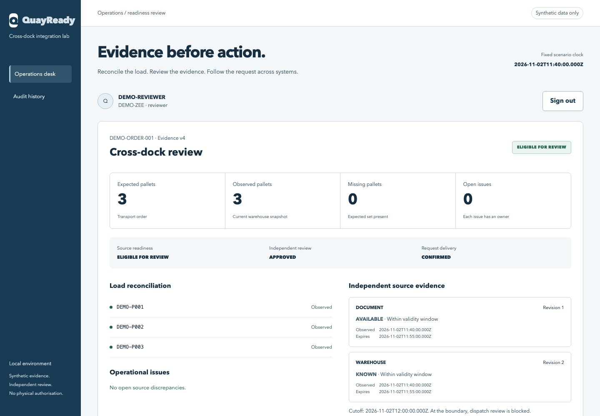

# QuayReady

**Cross-dock Readiness & Integration Lab**

Reliable logistics integration, from warehouse evidence to transport review.

Three pallets are expected. Two are observed. QuayReady explains the missing evidence, reconciles a corrected source snapshot, requires independent review of that exact evidence version and reliably transfers a dispatch-review request to an independently persisted mock-TMS.

This is an independent, AI-assisted portfolio and learning project with synthetic data. It is not an official or commissioned company application, a real vendor integration, customs clearance or physical departure authorisation. No company endorsement, production compliance, measured ROI or professional client experience is claimed.



**Public portfolio release candidate `0.2.0rc2`.** [Source code and tests](https://github.com/phlppgdfry/quayready) are available under MIT. [Explore the public showcase](https://phlppgdfry.github.io/quayready/). [Hosted verification](docs/hosted-validation.md) and [release closure](docs/release-closure.md) record the review and publication evidence. The GitHub prereleases and their reviewed evidence are public; no Python or npm package is published. [Final sign-off](docs/final-signoff.md) · [Actual verification](docs/release-verification.md) · [Case study](docs/case-study.md) · [Architecture](docs/architecture.md) · [Release notes](docs/release-notes.md)

## Explore in a browser

The independent static showcase has a step-by-step workflow simulation, failure/recovery lab, selectable architecture, real screenshots and a captioned authentic application walkthrough. Simulations are explicitly labelled and never call the Python backend.

After installing the development dependencies below:

```sh
.venv/bin/python scripts/build_showcase.py
.venv/bin/python -m http.server 18790 --bind 127.0.0.1 --directory .runs/site
```

Open **http://127.0.0.1:18790/quayready/**. This is a static local preview, not a public deployment. The build works under repository subpaths and uses an explicit public-asset allowlist. [Showcase source](showcase/index.html) and [publication decisions](docs/publication.md) remain separate from backend authority. No dead live-demo or CI badge is displayed.

## Engineering capabilities

- Strict authenticated order/snapshot APIs; canonical idempotency, revision guards and committed conflicts.
- Deterministic readiness, current-snapshot pallet sets, hard holds, expiry and cutoff boundaries.
- Stable-subject independent approval, version-bound proposals, server-side roles/site scope and CSRF.
- Approval plus immutable outbox atomically persisted; SQL constraints prevent orphan approval.
- Separate target HTTP process and database; persistent unique effect and receipt lookup.
- Bounded automatic retries, absolute HTTP deadline, response-size limits, leases, generation fencing and restart recovery.
- Explicit reviewer-authorised **GET-only** reconciliation of terminal uncertainty; no force-send, new identifier or budget reset.
- Real process overlap, injected result-COMMIT failure, hostile-response probes, contract/security tests, browser/axe checks and genuine evidence.

The guarantee is **bounded at-least-once delivery attempts with an idempotent target effect under the simulated contract**. Neither eventual delivery nor universal exactly-once processing is promised.

## Quick start: real application

Prerequisites: CPython **3.13**, SQLite **>=3.37** with JSON, Node **24** for development-only formatting/accessibility tools. The static output itself has zero runtime framework dependencies. No Docker or paid service is required. Clone the public repository, then run from its root:

```sh
git clone https://github.com/phlppgdfry/quayready.git
cd quayready
python3.13 -m venv .venv
.venv/bin/python -m pip install -r requirements-dev.lock
.venv/bin/python -m pip install -e . --no-deps --no-build-isolation
npm ci --ignore-scripts
.venv/bin/python -m playwright install chromium
.venv/bin/quayready init
```

Start app and target in **separate terminals**:

```sh
.venv/bin/quayready serve
```

```sh
.venv/bin/quayready target
```

In a third terminal:

```sh
.venv/bin/quayready seed
.venv/bin/quayready credentials --role operator
```

Open **http://127.0.0.1:8080** using that exact host. Paste your locally generated operator token into the login screen. Observe 2/3 pallets and missing P003.

```sh
.venv/bin/quayready correct
```

Refresh: evidence v4 becomes eligible. Create a proposal. Attempt self-approval to observe `SELF_APPROVAL`: the operator intentionally also has the reviewer role, so the server proves that role membership cannot bypass stable-subject separation. Sign out and obtain a genuinely different identity:

```sh
.venv/bin/quayready credentials --role reviewer
```

Sign in as reviewer and approve. The request is **QUEUED**, not yet delivered. Then run:

```sh
.venv/bin/quayready worker --once
```

Refresh for the independent target receipt. `worker` without `--once` loops. The workbench displays actual persisted state, not a scripted success screen.

## Failure and recovery demo

Preserve previous evidence by choosing a new run. Stop only processes you started. Use the same `--directory` with **every command**:

```sh
.venv/bin/quayready init --directory .runs/lost-response
.venv/bin/quayready serve --directory .runs/lost-response
```

In another terminal:

```sh
QUAYREADY_TARGET_FAULT=drop-after-commit .venv/bin/quayready target --directory .runs/lost-response
```

Repeat seed → correct → operator proposal → independent reviewer approval for that directory. Run `worker --directory .runs/lost-response --once`. The target really commits, then intentionally truncates the HTTP response; the app shows **RETRY_WAIT**, never assumed success. Wait at least two seconds, then run the worker command again: GET of the original dispatch ID confirms its original receipt. The injected target fault intentionally emits a protocol-error log after commit.

Automatic budgets are three reserved POSTs and three lookups. Terminal uncertainty stops in MANUAL_REVIEW. A reviewer can use **Look up target receipt** for one bounded GET-only investigation. It never resends, resets counters or removes the dispatch barrier without a matching receipt. An absent receipt is still uncertainty, not proof that an in-flight request can never arrive.

A genuine [captioned walkthrough](evidence/rc/video/walkthrough.webm) and [transcript](docs/demo-transcript.md) show the local scenario, including lost response and a new worker process. No visible credentials, voiceover or fictional target animation is included.

## Architecture


One Python codebase contains the FastAPI/Jinja workbench, pure domain rules, explicit SQL store, worker and separate mock target. **app.db** owns evidence/review/outbox/audit; **target.db** owns trusted synthetic orders and unique target effects. Only local HTTP crosses that integration boundary.

App migration 001 is preserved. Target migration 002 validates E1 DDL before adding checked migration history and retains existing effects. Unknown/drifted schemas stop startup. No network occurs in an open app transaction; results use generation fencing.

Technology: Python, FastAPI, Jinja, explicit SQLite, minimal browser JavaScript, pytest, real local HTTP and pinned GitHub Actions. The public showcase uses vanilla JavaScript/CSS plus a small Python static exporter. No React, cloud platform, broker or microservices infrastructure is needed.

## Verify and inspect evidence

```sh
.venv/bin/python scripts/verify.py
.venv/bin/python -m pip_audit --format json --output evidence/rc/dependency-audit.json
npm audit --audit-level=low
```

The first command runs formatting, linting, mypy, dependency integrity, Bandit, package build, all tests, static export, relative-link checks and local secret canaries. It starts only test-owned processes on temporary loopback ports. Chromium and `npm ci` are required. Advisory scans require network access and are recorded separately.

Original E1 evidence remains under `evidence/`. New release evidence is under `evidence/rc/`, identified by the tested input-tree fingerprint and actual commands. [Release verification](docs/release-verification.md) explains results, resolved defects, incomplete/manual checks and limits. [Historical E1 verification](docs/verification.md) remains available.

Verification Actions use upstream SHA pins and read-only repository permissions. The separately dispatched Pages workflow grants Pages/OIDC write only to its deploy job and publishes only the approved static export, with no production secrets. No hosted success badge is claimed before an actual run. Automated accessibility checks supplement real keyboard, responsive and visual review; no WCAG certification or professional penetration test is claimed.

## Security and limitations

Random local credentials stay in ignored `.runs/`, with restrictive directory/file permissions. Stable subjects, role/site filtering, exact Origin/Host, CSRF, strict bounded JSON, parameterised SQL, escaped output and CSP protect the local demonstration. Session/config repr excludes secret fields. See [SECURITY](SECURITY.md).

The default **domain clock is fixed at 2026-11-02 11:40 UTC**. Worker deadlines/leases/retries and sessions use real time. Frozen domain time makes the scenario reproducible; it is not live warehouse freshness. Sessions expire after 30 minutes and restart requires sign-in. Loopback HTTP omits the Secure cookie attribute; production identity/transport must be designed separately.

SQLite remains single-writer. Local administrators can alter files and audit protections. No production availability, privacy/compliance certification, real-world ROI, physical departure or customs authority is inferred. A second person's cold start, human security review and the owner's independent mastery remain open human gates.

## Developer guide and troubleshooting

- `init` refuses to overwrite an existing run. Reset means `init --directory NEW`, retaining old evidence. There is no destructive downgrade or counter-reset button.
- If ports are occupied, initialise with `--app-port 18080 --target-port 18081`; use that directory everywhere and the exact new origin. Never stop unrelated processes.
- Explicit `QUAYREADY_CONFIG` takes precedence over `--directory`; unset it before switching runs.
- After frontend edits: `npm run format`. After Python edits: `.venv/bin/ruff format src tests scripts`. Run the verification command before committing.
- Regenerate original social art with `python scripts/render_assets.py`; reproduce the real recording with `python scripts/record_demo.py`. These use local browsers and owned processes. Normal verification does not repeatedly record a 100-second video.
- Builds and run data are ignored; do not commit `.runs/`, `node_modules/`, package build intermediates or tokens. Public export is allowlisted and checked for stale extra files.

## Documentation and learning

| Purpose | Document |
|---|---|
| Business problem, results and reflection | [Case study](docs/case-study.md) |
| System context, data flow, schema and recovery | [Architecture](docs/architecture.md) · [Implementation](docs/implementation.md) |
| HTTP contracts | [OpenAPI 3.1.1](src/quayready/contracts/openapi.json) |
| Verification, security and honest limits | [Release evidence](docs/release-verification.md) · [SECURITY](SECURITY.md) |
| Demo and interview explanation | [Transcript](docs/demo-transcript.md) · [Mastery exercises](docs/learning.md) · [Interview package](docs/interview-package.md) |
| Product identity and accessibility | [Design system](docs/design-system.md) |
| Publication, release and reusable portfolio text | [Publication mechanism](docs/publication.md) · [Release closure](docs/release-closure.md) · [Portfolio description](docs/portfolio-description.md) |
| Version changes | [Changelog](CHANGELOG.md) · [Release notes](docs/release-notes.md) |
| Contributions and neutral provenance | [Contributing](CONTRIBUTING.md) · [Provenance](docs/provenance.md) |

AI-generated code and material do not prove personal expertise. Start with an unaided SQL query, a boundary test, two-session self-approval rejection and a narrated timeout recovery. Record assistance honestly.

MIT licensed. The private research/strategy repository is separate and untouched. No unrelated portfolio code or proprietary documents were copied.
