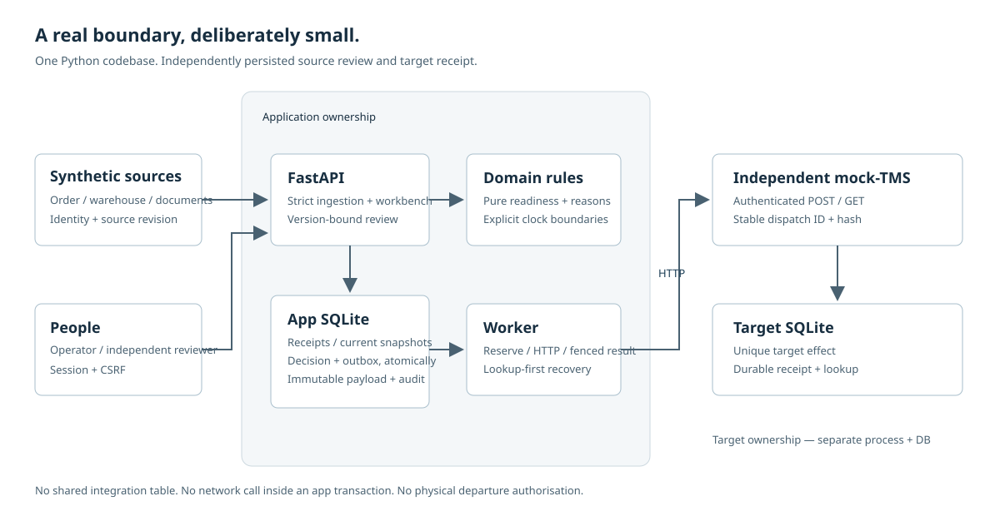
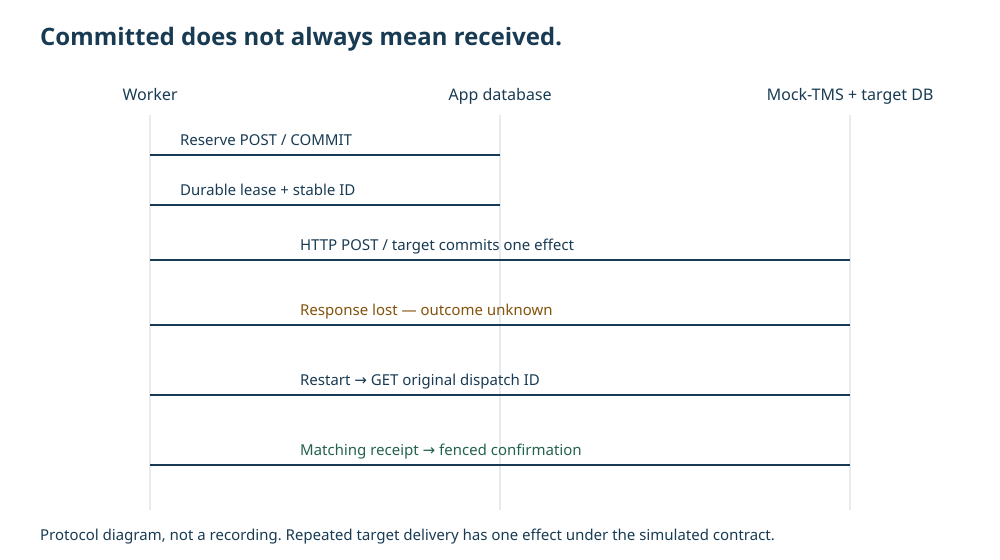

# QuayReady architecture

One Python package serves a FastAPI/Jinja app, an independently restartable mock-TMS and a worker. The independent target is deliberately a separate process and database to demonstrate a real HTTP boundary. No additional service platform is required.

## Ownership and data flow

Synthetic source identities send a transport order and complete warehouse/document snapshots. The app owns immutable inbound receipts, current snapshot pointers, pallet memberships, issue episodes, proposal evidence, decisions, outbox and audit. It computes readiness from current snapshots, never the union of scan history.

The operator creates a proposal bound to evidence version/hash and a five-minute maximum window. A different stable subject decides. Approval and immutable outbox commit under BEGIN IMMEDIATE, with deferred foreign keys preventing an orphan APPROVE.

The worker reserves and commits a lease/counter before HTTP. It performs no network operation inside an app transaction. A generation and unexpired lease fence the result. Target timeout/response loss means uncertainty. GET lookup precedes any permitted resend, with persisted due times and bounded budgets.

The target owns trusted synthetic orders, unique effects and immutable receipts. Matching repeat dispatch ID/hash returns the original receipt. A different ID for the same shipment cannot create a second effect. SQLite constraints are the final local guard, not just an application-level check.

## Manual reconciliation

A reviewer with a valid local session and CSRF may POST an empty object to `/v1/deliveries/{dispatchId}/reconcile`. This authorises one bounded GET of an existing MANUAL_REVIEW dispatch. A reserved generation prevents an older concurrent investigation overwriting a newer one. A matching receipt confirms the historical effect; 404/failure leaves uncertainty and the dispatch barrier intact. Automatic budgets and payload identity never reset. Request and outcome are audited. It is not a force-send operation.

## Schema evolution

App schema 001 remains unchanged and checksum-checked. Target migration 002 adds a migration history to E1 targets, first validating their DDL against an independently instantiated reference, then recording both checksums atomically. Existing receipts/effects are retained. Unknown/drifted schemas stop startup. Recovery is fix-forward or a new synthetic run, never destructive downgrade.

## State boundaries

Readiness: NEEDS_REVIEW, BLOCKED or ELIGIBLE_FOR_REVIEW. Proposal: pending, approved, rejected, invalidated or expired. Delivery: queued, sending, retry-wait, confirmed, manual review or cancelled-before-send. A confirmed historical request does not assert current source freshness or physical readiness.

After a POST reservation, evidence changes permit lookup only. A target receipt can confirm a historical effect with a post-approval-change issue; GET 404 cannot prove that an old in-flight packet will never arrive. Before any reservation, cancellation can truthfully be recorded.

## Tradeoffs and enterprise changes

Explicit SQL and SQLite make local transactions and failure states inspectable. They do not establish a production workload choice. A real deployment requires supplier and source-authority contracts, SSO, durable operational identities, TLS, backup/restore exercises, support ownership, privacy assessment, service-level objectives, capacity measurements and change control. The lab deliberately adds no AI, broker, Kubernetes or speculative microservices.

See [verification](release-verification.md), [local guide](public-guide.md) and [business case study](case-study.md).

## Static-site decision

The portfolio uses vanilla JavaScript and modern CSS with a small allowlisted Python exporter. TypeScript or a static framework would add a compiler/dependency lifecycle for one page of controlled presentation data without strengthening the backend boundary. Node tools are development-only (formatting and axe); the built site has no framework runtime or backend requirement. All simulations are explicitly labelled and have no operational authority. Original diagrams have readable component/text alternatives on mobile and without JavaScript.

The mock credential and trusted seed are explicitly bound to DEMO-ZEE. Other configured sites are used to test API isolation, not to imply multi-site integration support. A worker encountering another site records manual review before reserving POST; manual investigation cannot use the wrong target scope. Supporting a second target site would require an explicit credential/contract/routing decision, not implicit reuse of a shipment reference.
