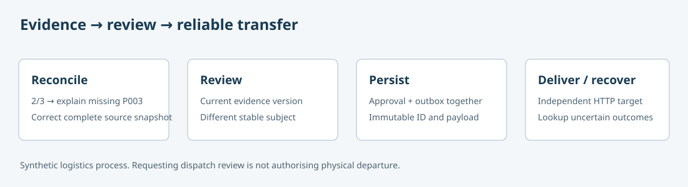

# QuayReady: an integration decision made inspectable

## Context and problem

Cross-dock operations depend on information with different owners: the transport order, warehouse observations and document evidence. In the illustrative scenario, three pallets are expected but only two appear in the current warehouse snapshot. Incomplete or inconsistent information creates uncertainty about whether a request should proceed. This is a general synthetic scenario, not evidence of a real company's operational problem.

## Objective

Explain the discrepancy, reconcile corrected evidence, require independent review of the exact evidence version and reliably transfer the approved dispatch-review request to another system. Physical departure, customs clearance and real vendor integration are outside scope.

## Approach

Begin with requirements, a rule decision table, data ownership, transaction boundaries and separately authored test scenarios. Implement the smallest closed chain, then challenge it with duplicate events, stale evidence, concurrency, response loss and process restart. Prefer deterministic automation where no generative judgment is required.

## Architecture and solution

A Python/FastAPI workbench uses explicit SQL and file-backed SQLite. It exposes the current evidence and issue owner. The source correction advances the evidence version; an operator requests review, and a different stable subject approves. Approval and outbox persist together. A worker transfers the immutable request over real HTTP to an independent mock-TMS with its own database.

## Reliability

Canonical event hashes distinguish identical replay from changed content. Source revisions protect the current projection. Proposal versions and expiry prevent stale review. Leases and generation fencing protect local worker state; the target also enforces unique effects. Response loss leads to lookup of the same dispatch identifier rather than assumed failure or immediate resend. Explicit manual investigation is GET-only.

## Verified results

The E1 baseline passed 39 local tests. The first E2 engineering checkpoint passed 73 tests, including hostile response deadlines, two overlapping worker processes, result-COMMIT failure, cross-site boundaries and terminal reconciliation. The release evidence records the final count, exact commands and platform separately. These are technical outcomes, not measured operational savings. Hosted CI and independent owner assessment are distinct gates.

## Limitations and reflection

The data, source authority and target contract are synthetic. The local identity model and trusted administrator assumption are not production security. No real-world ROI, availability, compliance or client experience is inferred. AI-assisted development produced code and learning material; personal competence requires independent explanation and modification exercises.

The most useful lesson is that failure is often ambiguous. A committed target effect and a missing client response can coexist. A smaller system that exposes that uncertainty is more credible than a broad demonstration that hides it behind a green status.

## Enterprise considerations

Validate the actual operational process with users; negotiate source/target ownership and idempotency with suppliers; define support, continuity and reconciliation responsibilities; assess build-versus-buy, lifecycle cost, backup and identity requirements. Those organisational decisions cannot be proven through a solo portfolio lab.
